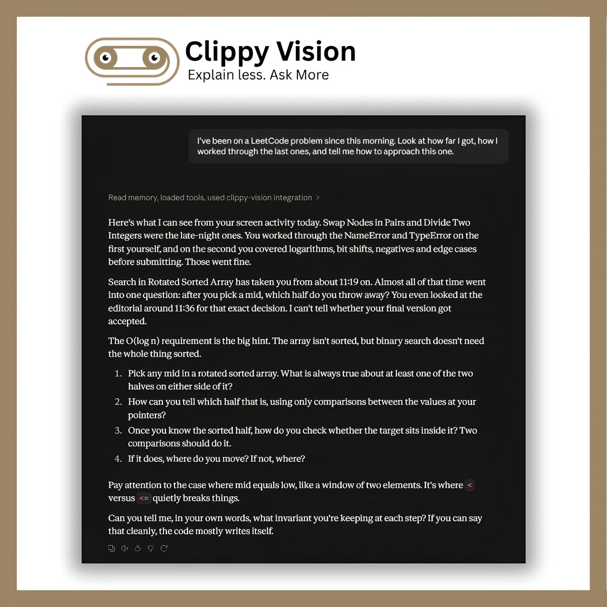

# Clippy Vision

Clippy Vision watches your work on this computer, stores a searchable activity history locally, and lets you ask about it through a connected MCP client such as Cursor, Claude Desktop, or VS Code. The desktop app captures, summarizes, and shows the timeline.

-blue)


[](#contributors)
[](https://www.codetriage.com/protocorn/clippy-vision)

<p align="center">
  
</p>

Ask in a connected MCP client, for example:

- "What was I working on before lunch?"
- "Which hotels did I look at yesterday?"
- "What was the error I encountered in my terminal?"

---

## Download

**Windows is tested for 2.0.** macOS validation is pending, so macOS 2.0 installers are not included yet. macOS downloads below are the previous release (**v1.3.1**). Linux is **experimental and X11 only**; an unsigned x86_64 AppImage is built in CI (see [docs/linux.md](docs/linux.md)). The README describes current `main`; some installer features differ from 1.3.1.

<p align="center">
  <a href="https://github.com/protocorn/clippy-vision/releases/download/v2.0.0/ClippyVision-Windows-Setup-2.0.0.exe"></a>
</p>

<p align="center">
  <a href="https://github.com/protocorn/clippy-vision/releases/download/v1.3.1/ClippyVision-macOS-arm64-1.3.1.dmg"></a>
  &nbsp;
  <a href="https://github.com/protocorn/clippy-vision/releases/download/v1.3.1/ClippyVision-macOS-x64-1.3.1.dmg"></a>
</p>

<p align="center">
  <a href="https://github.com/protocorn/clippy-vision/releases/latest">All releases &amp; older versions</a>
  &nbsp;·&nbsp;
  <a href="https://github.com/protocorn/clippy-vision/commits/main"></a>
  &nbsp;
  <a href="https://github.com/protocorn/clippy-vision/releases/latest"></a>
</p>

The installers are unsigned: on Windows choose **More info → Run anyway**, and on macOS right-click → **Open** the first time. First run needs internet for an app-managed Python runtime (if you do not already have Python 3.11+), Python packages, and the default summary model (`qwen3:8b`, about 5 GB). `llama3.2:3b` is a low-memory option that is less accurate. You can pick a different model later in Settings.

**Trying Clippy?** [Share feedback (5 min)](https://docs.google.com/forms/d/e/1FAIpQLScqsgeWGLdUS_Ba0Me0LPQH8QRrwnIgGiGGHwLElVuqIpfcxQ/viewform).

### Requirements

| | Minimum | Recommended |
|--|---------|-------------|
| OS | Windows 10 / 11 (64-bit), macOS 12+, or Linux (Ubuntu 22.04+, experimental, X11 only) | Windows 11 or a current macOS |
| System RAM | 8 GB | 16 GB |
| Graphics memory | Not required. Integrated graphics or Apple unified memory is enough | 4 GB+ dedicated on Windows, or 16 GB unified memory on Apple silicon |
| Free disk | 8 GB | 10 GB+ |
| **Python runtime** | No system Python required for the packaged app. Setup downloads a relocatable CPython 3.12 if needed. | **Python 3.12** (app-managed or `CLIPPY_PYTHON`) |

**Python is not inside the Windows installer, Linux AppImage, or macOS package** (keeps those artifacts around 100–130 MB). First-run setup downloads a relocatable [python-build-standalone](https://github.com/astral-sh/python-build-standalone) CPython 3.12 into app data and then creates the same app-managed venv as before. `requirements.txt` does not pin a Python version. Resolution order (`electron-ui/electron/lib/paths.js`): `CLIPPY_PYTHON` if set, else a healthy app venv, else the downloaded runtime, else `python3` / `python` from PATH. CI unit tests and the release dry-run still install Python 3.12 on the runner and set `CLIPPY_PYTHON`. A separate `managed-python-venv` job on Ubuntu, Windows, and macOS (arm64 + Intel x64) downloads the pinned standalone CPython, verifies SHA-256, and creates a venv. The setup wizard parses `python --version` and requires **Python 3.11+**.

**When Python is missing, the setup wizard (`electron-ui/electron/lib/setup.js`) does this:**
- It parses `--version` and requires Python 3.11+. A healthy system 3.11+ interpreter is used when present so the extra download is skipped.
- If nothing suitable is found (or PATH Python is older than 3.11), it **downloads a relocatable CPython 3.12** (~25–30 MB) with a progress bar, verifies the SHA-256, and extracts it under app data (`python-runtime/`). No winget, Homebrew, or apt install of system Python.
- Packages still go into the app-managed venv (`python-venv/`). Linux `python3-venv` / Ollama `zstd` error handling is unchanged.
- If the download fails, Retry and an optional [python.org/downloads](https://www.python.org/downloads/) link. Advanced: set `CLIPPY_PYTHON`.

**Advanced:** point Clippy at a specific interpreter before launch:

```powershell
$env:CLIPPY_PYTHON = "C:\path\to\python.exe"
```

```bash
export CLIPPY_PYTHON=/path/to/venv/bin/python3
```

Linux support is **experimental and X11 only. Wayland is not supported.** On X11, screenshots use `mss` (optional crop via `xdotool`). Window titles use `xdotool`, clipboard uses `wl-paste`/`xclip`/`xsel`. AT-SPI accessibility text is implemented; it is covered by CI unit tests, not a real desktop. An unsigned Linux AppImage is built in CI. Install and run steps: [docs/linux.md](docs/linux.md).

The setup wizard checks these numbers before installing. Below minimum → setup is blocked. Between minimum and recommended → you can continue with a warning that summaries may feel slower. Homebrew, dependency, and permission troubleshooting: [docs/usage.md](docs/usage.md#installation-troubleshooting). Lower-spec machines: [CONTRIBUTING.md](CONTRIBUTING.md#lower-spec-machines).

---

## Quick Start

1. Download and install Clippy. You do not need to install Python first.
2. Complete the setup wizard (Ollama if missing, then Python packages). Setup downloads `qwen3:8b` automatically for summaries. `llama3.2:3b` is a low-memory option that is less accurate; change the model later in Settings.
3. Leave Clippy running to build your activity history.
4. Open **Settings → Connect apps**, connect your agent, and ask about your activity.

More detail: [docs/usage.md](docs/usage.md) · [docs/mcp.md](docs/mcp.md) · client guides: [Claude Desktop](docs/mcp-clients/claude-desktop.md) · [LM Studio](docs/mcp-clients/lm-studio.md)  
Build from source: [CONTRIBUTING.md](CONTRIBUTING.md#building-from-source)

---

## Features

- Searchable activity history across apps
- Local summaries and long-term memory
- Access through MCP-compatible agents
- A timeline for reviewing and deleting activity
- Capture and privacy controls

---

## Privacy

- Clippy captures foreground windows, clipboard, typing metrics, and screenshots.
- Capture, summarization, and storage run locally on this computer.
- Connected cloud agents can receive retrieved memory through MCP tool replies.
- Connected clients have access to all exposed Clippy tools.
- Redaction is best effort. Private-browsing detection is on by default: Chrome, Edge, and Brave on Windows and macOS; Firefox and Opera on Windows (and attempted but untested on macOS); Vivaldi on Windows. Vivaldi, Safari, and Linux are not covered. See the [coverage table](docs/usage.md#private-browsing).
- You can pause capture and delete stored activity from the tray or timeline.

Full guide (retention defaults and detailed behavior): [docs/usage.md](docs/usage.md#privacy-settings).

<p align="center">
  
</p>

---

## Documentation & Roadmap

| Guide | Contents |
|-------|----------|
| [docs/usage.md](docs/usage.md) | Capture controls, privacy, accessibility, install troubleshooting |
| [docs/linux.md](docs/linux.md) | Experimental Linux install and run (X11 only; AppImage, first-run Python download, capture tools) |
| [docs/mcp.md](docs/mcp.md) | Supported clients, Copy JSON, tool reference, access permissions |
| [docs/mcp-clients/claude-desktop.md](docs/mcp-clients/claude-desktop.md) | Step-by-step Claude Desktop setup: config location, restart, verification |
| [docs/mcp-clients/lm-studio.md](docs/mcp-clients/lm-studio.md) | Step-by-step LM Studio setup: MCP configuration, local model, test query, privacy |
| [docs/architecture.md](docs/architecture.md) | Tech stack, capture pipeline, summarization, distillation, schema |
| [CONTRIBUTING.md](CONTRIBUTING.md) | Build from source and contribution guide |
| [PROJECT_VISION.md](PROJECT_VISION.md) | Roadmap, principles, and known limitations |

---

## Contributing

See [CONTRIBUTING.md](CONTRIBUTING.md) for setup steps, building from source, and good first issues.

---

## Contributors

Thanks to everyone who has shipped code, docs, design, or ideas.

[](#contributors)
[](https://github.com/protocorn/clippy-vision/graphs/contributors)

<!-- CONTRIBUTORS-STATS:START -->

| | Contributor | What they built |
| :---: | :--- | :--- |
| <a href="https://github.com/protocorn"></a> | <a href="https://github.com/protocorn"><b>@protocorn</b></a><br/><sub>💻 📖 🎨 🤔 🚧</sub> | Designed the core app: agent, vision pipeline, memory system, and the Electron desktop shell. |
| <a href="https://github.com/rusetiq"></a> | <a href="https://github.com/rusetiq"><b>@rusetiq</b></a><br/><sub>💻 📦</sub> | Brought Clippy Vision to macOS: native screen capture, permissions, and Apple Silicon + Intel packaging. |
| <a href="https://github.com/cursoragent"></a> | <a href="https://github.com/cursoragent"><b>@cursoragent</b></a><br/><sub>💻</sub> | <a href="https://github.com/protocorn/clippy-vision/commits?author=cursoragent">See their commits →</a> |
| <a href="https://github.com/ABarpanda"></a> | <a href="https://github.com/ABarpanda"><b>@ABarpanda</b></a><br/><sub>💻</sub> | <a href="https://github.com/protocorn/clippy-vision/commits?author=ABarpanda">See their commits →</a> |
| <a href="https://github.com/Afrin-banu-A"></a> | <a href="https://github.com/Afrin-banu-A"><b>@Afrin-banu-A</b></a><br/><sub>💻</sub> | <a href="https://github.com/protocorn/clippy-vision/commits?author=Afrin-banu-A">See their commits →</a> |
| <a href="https://github.com/vitorparras"></a> | <a href="https://github.com/vitorparras"><b>@vitorparras</b></a><br/><sub>💻</sub> | <a href="https://github.com/protocorn/clippy-vision/commits?author=vitorparras">See their commits →</a> |
| <a href="https://github.com/Furox-Art"></a> | <a href="https://github.com/Furox-Art"><b>@Furox-Art</b></a><br/><sub>💻</sub> | <a href="https://github.com/protocorn/clippy-vision/commits?author=Furox-Art">See their commits →</a> |
| <a href="https://github.com/vaishn4vi"></a> | <a href="https://github.com/vaishn4vi"><b>@vaishn4vi</b></a><br/><sub>💻</sub> | <a href="https://github.com/protocorn/clippy-vision/commits?author=vaishn4vi">See their commits →</a> |
| <a href="https://github.com/adity982"></a> | <a href="https://github.com/adity982"><b>@adity982</b></a><br/><sub>💻</sub> | <a href="https://github.com/protocorn/clippy-vision/commits?author=adity982">See their commits →</a> |
| <a href="https://github.com/Draoui-Haroun"></a> | <a href="https://github.com/Draoui-Haroun"><b>@Draoui-Haroun</b></a><br/><sub>💻</sub> | <a href="https://github.com/protocorn/clippy-vision/commits?author=Draoui-Haroun">See their commits →</a> |
| <a href="https://github.com/KeuqS"></a> | <a href="https://github.com/KeuqS"><b>@KeuqS</b></a><br/><sub>💻</sub> | <a href="https://github.com/protocorn/clippy-vision/commits?author=KeuqS">See their commits →</a> |
| <a href="https://github.com/shaurya703"></a> | <a href="https://github.com/shaurya703"><b>@shaurya703</b></a><br/><sub>💻</sub> | <a href="https://github.com/protocorn/clippy-vision/commits?author=shaurya703">See their commits →</a> |
| <a href="https://github.com/cyforkk"></a> | <a href="https://github.com/cyforkk"><b>@cyforkk</b></a><br/><sub>💻</sub> | Made errors readable: replaced bare HTTP status codes with real API error messages in chat. |
| <a href="https://github.com/tadaokatzuki"></a> | <a href="https://github.com/tadaokatzuki"><b>@tadaokatzuki</b></a><br/><sub>💻</sub> | <a href="https://github.com/protocorn/clippy-vision/commits?author=tadaokatzuki">See their commits →</a> |
| <a href="https://github.com/icn5381"></a> | <a href="https://github.com/icn5381"><b>@icn5381</b></a><br/><sub>💻</sub> | <a href="https://github.com/protocorn/clippy-vision/commits?author=icn5381">See their commits →</a> |
<!-- CONTRIBUTORS-STATS:END -->

How to get on this wall: [CONTRIBUTING.md](CONTRIBUTING.md#contribution-types).

---

## License

AGPL-3.0. See [LICENSE](LICENSE). Releases already published through v1.3.1 stay under MIT. A commercial license for companies that cannot use AGPL is not written yet.
