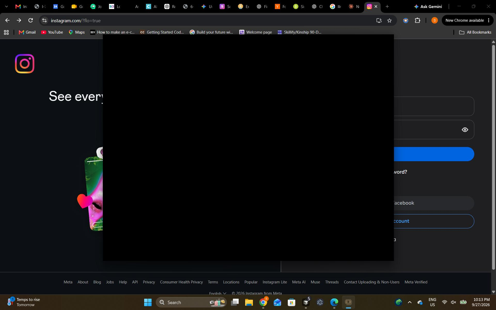

# Usage Guide

How to run Clippy Vision day to day: capture controls, privacy settings, accessibility behavior, and install troubleshooting.

For connecting an agent, see [mcp.md](mcp.md). For how capture and memory work internally, see [architecture.md](architecture.md).

---

## Capture controls

Capture starts when the app launches. Closing the window leaves the tray icon running; capture continues from the tray.

**Pause vs stop**

- **Pause** turns capture off for a timed period, then turns it back on.
- **Stop** turns capture off until you start it again.

Use the button in the app or the tray icon. Clippy shows a desktop notification when capture state changes.

Pause capture whenever a window must not be stored. Privacy redaction is best effort; pause is the reliable off switch.

---

## Privacy settings

Open **Settings** to manage what gets stored.

### Private apps

Apps you list under privacy are blacked out whenever they are visible, not only when they are in front. Common messaging apps can be toggled there, including Instagram, WhatsApp, Telegram, Signal, Slack, and Discord.

### Private browsing

Private browsing protection is on by default. When a private window is detected, Clippy:

- paints the window black,
- does not store the address,
- saves the title as "Private window".

Coverage depends on the operating system. "Untested" means detection is attempted but has not been verified on that platform:

| Browser (private mode) | Windows | macOS | Linux |
| --- | --- | --- | --- |
| Google Chrome (Incognito) | Covered | Covered | Not yet |
| Microsoft Edge (InPrivate) | Covered | Covered | Not yet |
| Brave (Private) | Covered | Covered | Not yet |
| Firefox (Private Browsing) | Covered | Untested | Not yet |
| Opera | Covered | Untested | Not yet |
| Vivaldi | Covered | Not covered | Not yet |
| Safari | Not covered | Not covered | Not yet |

Windows detection is exercised by unit tests in CI only. On Linux there is no private-window detection yet, so a private window is captured like any other. Pause capture when a private window must not be stored. Linux install, capture helpers, and these privacy limits: [linux.md](linux.md#privacy-limits-on-linux).

### What the privacy layer does

Before text or a screenshot is stored, Clippy tries to:

- Paint password fields and other single-line sensitive fields.
- Strip API keys, tokens, private keys, and other secret-shaped text.
- Black out Clippy's own window in every screenshot.
- **Honor OS-level capture opt-out signals**: When the foreground window asks the OS not to be captured, Clippy skips screenshots, OCR, accessibility text, and clipboard capture for that moment and records only a minimal event marker with no content.

**OS-level opt-out mechanisms honored:**
- **Windows**: `SetWindowDisplayAffinity` with `WDA_EXCLUDEFROMCAPTURE` or `WDA_MONITOR` (used by password managers and some secure apps)
- **macOS**: `NSWindowSharingNone` (`kCGWindowSharingState == 0`) on the frontmost window of the foreground app, via CGWindowList
- **Linux**: No standardized per-window mechanism. Clippy falls back to an exact-name list of well-known password managers (not substring matching). Browser private windows stay on the existing private-window path. Details: [linux.md](linux.md#privacy-limits-on-linux).

The same redactor runs again on every MCP tool reply. Screenshot file paths are left out. A window you marked private is returned as "This moment was private" with the app and time only. If that filter fails, the tool returns nothing. The copy on this computer is unchanged.

This is a best effort, not a guarantee.

<p align="center">
  
</p>

### Retention defaults

| Data | Default retention | Configurable range |
|------|-------------------|--------------------|
| Raw events | 7 days | 1–30 days in Settings |
| Session summaries | 90 days | 1–180 days in Settings |
| Screenshots | 1 day (high-signal frames up to 7) | See Settings (`screenshot_retention_max_days`) |
| Long-term memory facts | Until you delete them | — |

OCR text on events remains after the JPEG is purged. You can delete one moment, one session, or one day from the timeline.

### Local network binding

The local API binds to `127.0.0.1` on a port chosen at launch. It is never reachable from your network.

### Update check

Clippy checks the public GitHub releases page for a newer version at most once every 12 hours. That request carries no screen, profile, or account data. Turn it off under **Settings → Updates**. Tool replies sent to an MCP client are separate: they leave the machine only if that client sends them on.

---

## Editor accessibility

For Cursor, VS Code, and other VS Code-based editors, Clippy turns on that editor's screen-reader accessibility setting when the app is in front and the setting is off. That is how the open file can be read. It does not turn on a Windows or macOS screen reader.

On macOS, Screen Recording and Accessibility permissions are required for screenshots, window titles, and password-field painting. Grant them when Clippy asks. If a prompt is dismissed, turn them on in **System Settings → Privacy & Security**.

---

## Asking about your activity

There is no in-app chat. Connect an MCP client under **Settings → Connect apps**, then ask in that app. The agent chooses which Clippy tool to call.

See [mcp.md](mcp.md) for supported clients, Copy JSON instructions, and the tool list.

---

## Installation troubleshooting

### Setup wizard fails at a step

Click **Retry** on the failed step. If it keeps failing, check the log panel in the wizard for the specific error.

### App stuck on the opening screen

The window opens once the local server answers a health check. The text model can still be loading after that. If the opening screen never leaves, the server did not become healthy. Close the app and open it again. It re-runs the preflight checks and returns to setup when something is missing.

### "Windows protected your PC" on install

The installers are unsigned. Click **More info → Run anyway**.

### macOS says the app cannot be opened

The disk image is unsigned. Right-click Clippy Vision and choose **Open**, then confirm. Grant Screen Recording and Accessibility when asked.

### Homebrew / dependencies on macOS

The setup wizard downloads a relocatable Python 3.12 runtime if Python 3.11+ is not already available, and uses Homebrew when Homebrew is already installed to install **Ollama**. If Homebrew is missing for Ollama, the wizard shows a manual-install message with a link to [ollama.com/download](https://ollama.com/download). Install Ollama yourself, then click **Retry**. `brew install ollama` is the same step the wizard tries when Homebrew is present. Python no longer requires Homebrew or python.org.

### Linux AppImage

Linux support is **experimental and X11 only. Wayland is not supported.** The unsigned AppImage, first-run Python download, capture helpers, and known warnings are in [linux.md](linux.md). **Install Ollama first** (`curl -fsSL https://ollama.com/install.sh | sh`, or [ollama.com/download/linux](https://ollama.com/download/linux)). Python is downloaded into app data if 3.11+ is not on PATH. If `libfuse2` is missing, run the AppImage with `--appimage-extract-and-run`.

### Windows winget missing or PATH stale after install

Python no longer uses winget. The wizard downloads a relocatable CPython 3.12 into `%APPDATA%\Clippy Vision\python-runtime\` when no Python 3.11+ is found. If `winget` is not available for **Ollama**, the wizard shows [ollama.com/download](https://ollama.com/download). After a successful Ollama winget install it re-reads PATH and probes known locations such as `%LOCALAPPDATA%\Programs\Ollama\ollama.exe` before asking you to retry.

### Ollama not found after install

Open a new terminal and run `ollama --version`. If not found, re-run setup or install it from [ollama.com](https://ollama.com/download). On Linux the wizard can run the official installer only after you click **Install** and confirm it needs sudo.

### Reset setup / reinstall

Delete `setup_complete.json` from the app data folder below. The setup wizard runs again on the next launch.

### Check if everything is working

The API listens on `127.0.0.1` at the port recorded in `api_process.json` next to the app data. It is not fixed at port 8000.

```powershell
# Windows
$state = Get-Content "$env:APPDATA\Clippy Vision\api_process.json" | ConvertFrom-Json
Invoke-RestMethod "http://127.0.0.1:$($state.port)/health"
python -c "import sqlite3, os; db=os.path.join(os.environ['APPDATA'],'Clippy Vision','data','events.db'); print(sqlite3.connect(db).execute('SELECT COUNT(*) FROM events').fetchone()[0], 'events')"
```

On macOS, in Terminal:

```bash
python3 -c "import json,urllib.request,pathlib; p=pathlib.Path.home()/'Library/Application Support/Clippy Vision/api_process.json'; port=json.loads(p.read_text())['port']; print(urllib.request.urlopen(f'http://127.0.0.1:{port}/health').read().decode())"
```

---

## File locations (installed)

Linux packaged paths: [linux.md](linux.md#file-locations-packaged-linux).

| Item | Windows | macOS |
|------|---------|-------|
| App data (DB, screenshots) | `%APPDATA%\Clippy Vision\data\` | `~/Library/Application Support/Clippy Vision/data/` |
| App Python runtime | `%APPDATA%\Clippy Vision\python-runtime\` | `~/Library/Application Support/Clippy Vision/python-runtime/` |
| App Python venv | `%APPDATA%\Clippy Vision\python-venv\` | `~/Library/Application Support/Clippy Vision/python-venv/` |
| Setup flag | `%APPDATA%\Clippy Vision\setup_complete.json` | `~/Library/Application Support/Clippy Vision/setup_complete.json` |
| API port | `%APPDATA%\Clippy Vision\api_process.json` | `~/Library/Application Support/Clippy Vision/api_process.json` |
| Ollama models | `%USERPROFILE%\.ollama\models\` | `~/.ollama/models/` |
| App install | `%LOCALAPPDATA%\Programs\Clippy Vision\` | `/Applications/Clippy Vision.app` |

A source run (`npm start`) stores the database in `core/data` inside the checkout, not in the installed-app folder. See [CONTRIBUTING.md](../CONTRIBUTING.md).

---

## Uninstall

Windows: **Settings → Apps → Clippy Vision → Uninstall**, or run the uninstaller in `%LOCALAPPDATA%\Programs\Clippy Vision\`.

macOS: drag **Clippy Vision** out of Applications.

To remove captured data, delete the app data folder in the table above. To remove Ollama models, delete the Ollama models folder in that table.
